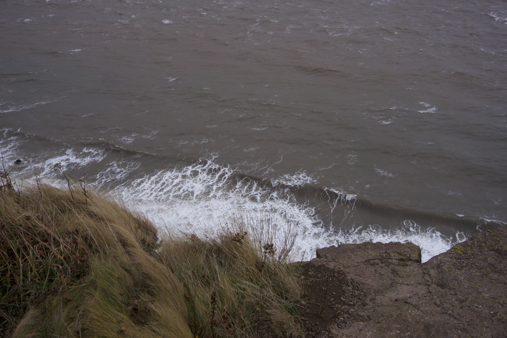
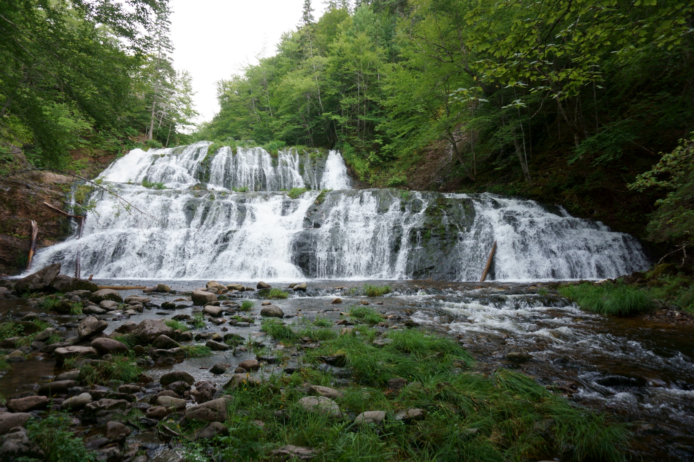
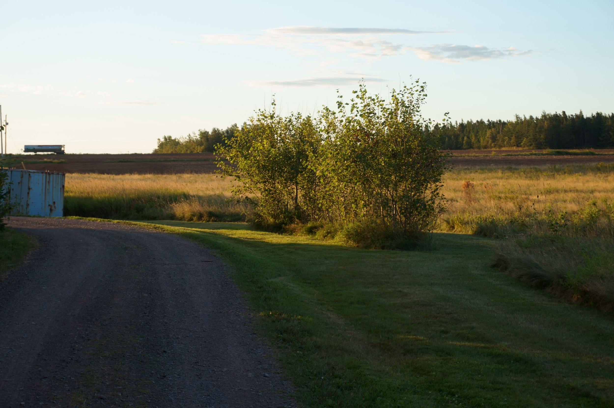
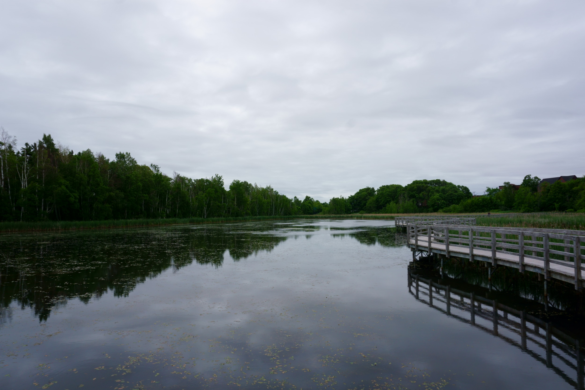
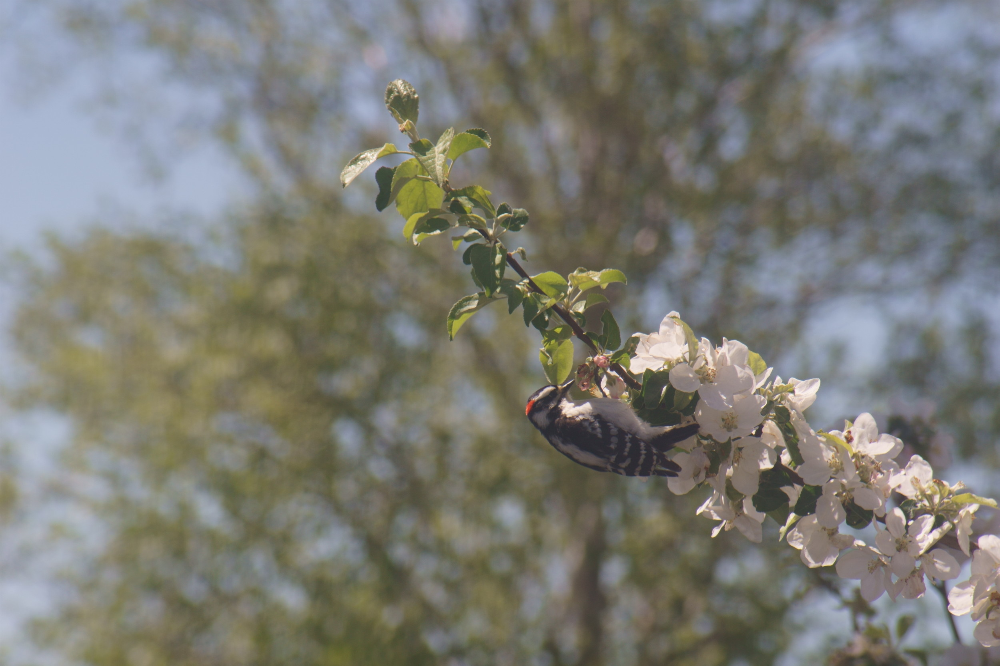
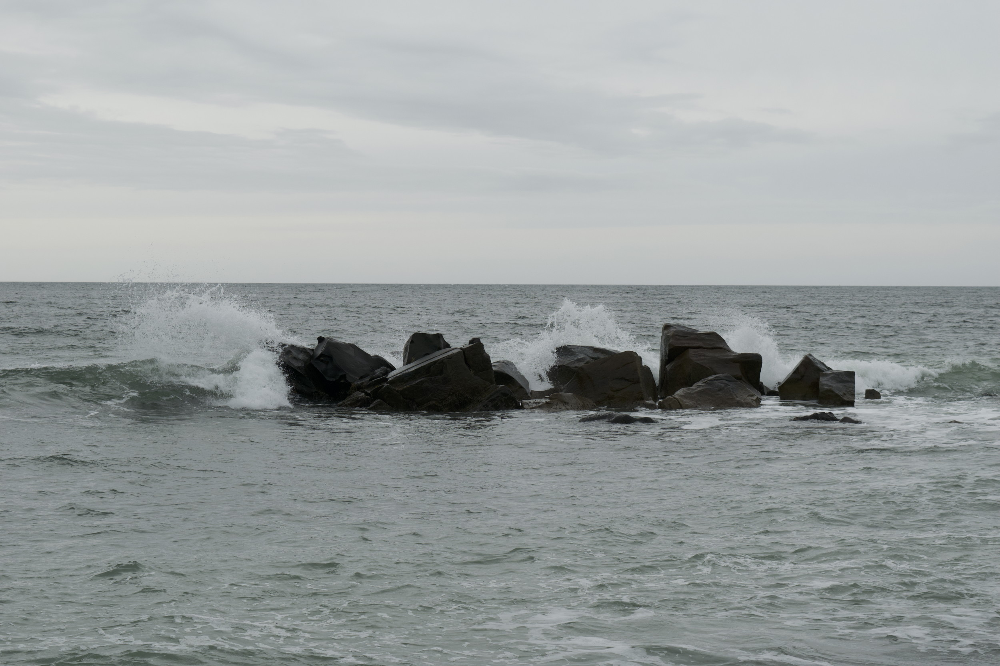
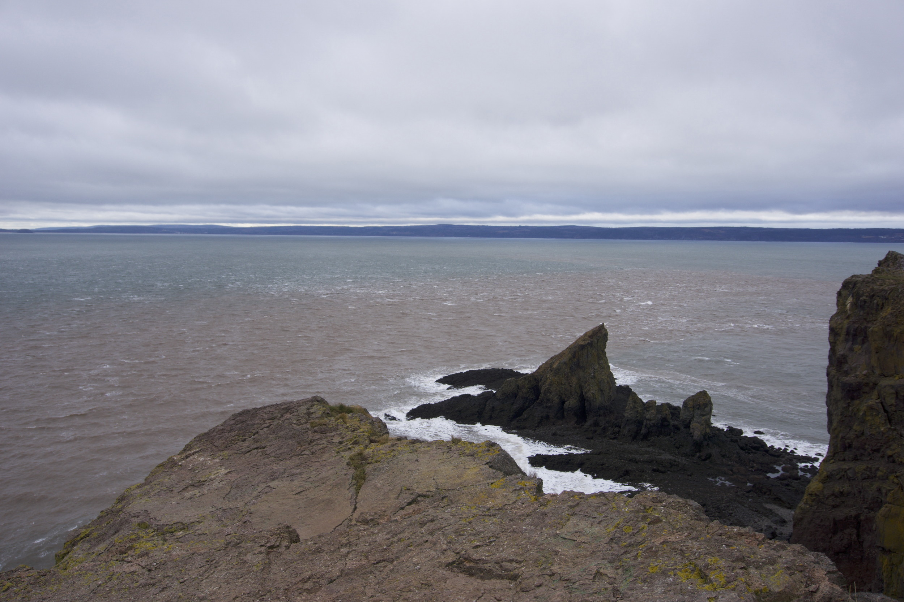

# Portfolio
Here are some examples of my work. This is both to share my work with you, and to remind myself of the things I've done over the years.

## Recordings

"Strike" is an orginal musical composition by Emmet Smith. All parts were written and performed by Emmet Smith in February of 2024.

<iframe style="aspect-ratio: 16 / 9; width: 100%" src="https://www.youtube.com/embed/d1se48HcD9E?si=aprfMZ5xCKkIBFz0" title="YouTube video player" frameborder="0" allow="accelerometer; autoplay; clipboard-write; encrypted-media; gyroscope; picture-in-picture; web-share" referrerpolicy="strict-origin-when-cross-origin" allowfullscreen></iframe>

This is a performance of "Nardis" written by Bill Evans and arranged by Mike Stern. Emmet Smith is playing drums, Ben (Donnie) Tucker is playing Keyboard, Leo Cox is playing Bass, and V Obritsch is playing Trumpet. This recording was made in February of 2024

<iframe style="aspect-ratio: 16 / 9; width: 100%" src="https://www.youtube.com/embed/NoFjo9jkXEk?si=D3aOc59Ybs0ZzvwA" title="YouTube video player" frameborder="0" allow="accelerometer; autoplay; clipboard-write; encrypted-media; gyroscope; picture-in-picture; web-share" referrerpolicy="strict-origin-when-cross-origin" allowfullscreen></iframe>

This is a performance of "Fee-Fi-Fo-Fum" written by Wayne Shorter. Emmet Smith is playing drums, Ben (Donnie) Tucker is playing guitar, Leo Cox is playing Bass, and V Obritsch is playing Trumpet. This recording was made in February of 2024. 

<iframe style="aspect-ratio: 16 / 9; width: 100%" src="https://www.youtube.com/embed/dfDAf3Zqdno?si=XgLCLRJA5u-25k6T" title="YouTube video player" frameborder="0" allow="accelerometer; autoplay; clipboard-write; encrypted-media; gyroscope; picture-in-picture; web-share" referrerpolicy="strict-origin-when-cross-origin" allowfullscreen></iframe>

## Performances

Soul Tides at Gaspereau Hall Fundraiser - September 20, 2026

Max Guitton Trio at Eastern Tea Bar - September 25, 2026

[Tobias Beale and Friends - May 2, 2026](https://musiqueroyale.com/event/2026/2026-05-02-tobias-beale-and-friends/)

[Max and Emmet + Play!: An Evening of Live Music in Two Parts - July 26, 2024](https://halifax.shambhala.org/event/736593-/)

[Halifax Regional Arts Senior Jazz Band, opening for Dalhousie Jazz Ensemble - November 29, 2023](https://www.dal.ca/news/2023/11/29/dalhousie-jazz-ensemble-2023.html)

## Photography

Click on an image to view it in a new tab

